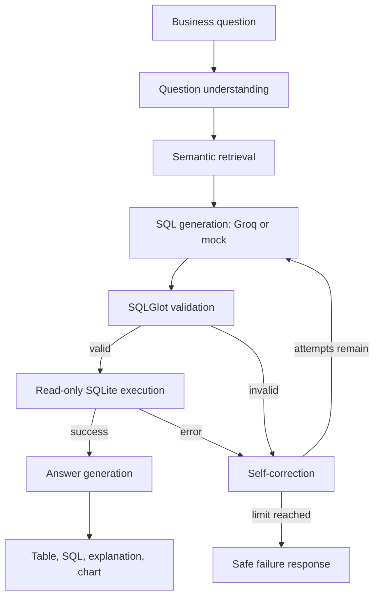
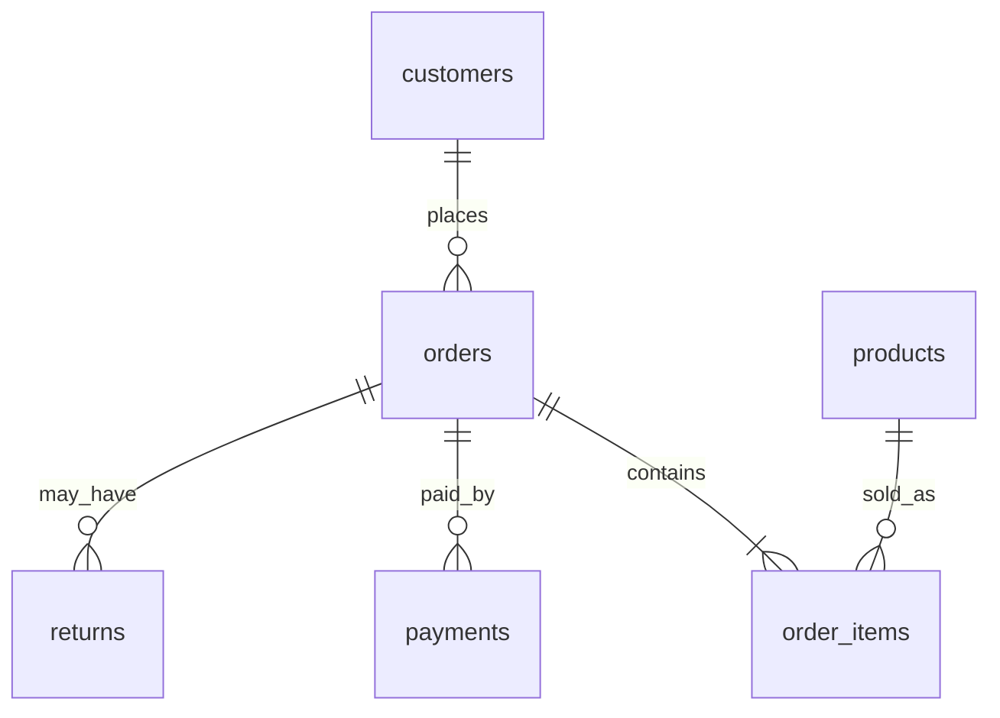

# Agentic Enterprise Data Analyst | OKF & SQL

A reproducible, laptop-scale demo of a semantic-layer-grounded natural-language-to-SQL analyst. It combines a synthetic retail database, metric definitions, SQL validation, read-only execution, bounded self-correction, and a Streamlit dashboard.

> **Status:** Synthetic data generation and deterministic mock mode are designed to work without credentials. LLM mode requires a Groq API key and installed dependencies. Benchmark results must be generated in your own environment; this repository does not claim an unmeasured accuracy improvement.

## Features

- Six related tables and ~30,000 generated business records (exact total depends on table mix).
- YAML semantic catalog with metric formulas, grain, joins, filters, and business rules.
- LangGraph workflow: understand → retrieve semantics → generate → validate → execute → correct (up to 3 attempts) → answer.
- SQLGlot validation, SQLite read-only query execution, statement restrictions, and row limits.
- Groq via `ChatGroq`; deterministic mock mode for tests/demos without API keys.
- Streamlit interface, Plotly charts, KPI summaries, semantic catalog explorer.
- 50 benchmark questions and an evaluation runner exporting CSV/JSON.

## Architecture



## Data model



Tables: `customers`, `products`, `orders`, `order_items`, `payments`, `returns`. The generator uses fixed seeds for repeatability. The database is synthetic and contains no real customer data.

## Semantic-layer design

`semantic_layer/metrics.yaml` is an **OKF-inspired** executable catalog, not a claim of conformance to a formal Open Knowledge Format specification. Each metric defines its expression, grain, source tables, join guidance, filters, and caveats. The catalog loader validates required fields and supports keyword-based retrieval.

Important assumptions:
- Revenue is recognized from `order_items.quantity * unit_price` for orders not cancelled.
- Net sales subtract item-level discounts and returned item value where return records exist.
- Gross profit is net sales minus item-level unit cost.
- To avoid fan-out, sales metrics should aggregate order items before joining to order-level payments or returns. Do not sum order totals after joining to both `payments` and `order_items`.
- `payments` may contain multiple payment rows per order; aggregate it by `order_id` first.
- Repeat customer rate is the share of customers with at least two non-cancelled orders in the selected period.
- CLV is a simplified historical net-sales total per customer, not a predictive lifetime model.

## Install

Python 3.10+ recommended.

```bash
python -m venv .venv
# Windows:
.venv\\Scripts\\activate
# macOS/Linux:
source .venv/bin/activate
pip install -r requirements.txt
cp .env.example .env
python scripts/init_database.py
```

Mock mode works without a Groq key:

```bash
# Windows PowerShell
$env:LLM_MODE="mock"
streamlit run app.py
# macOS/Linux
LLM_MODE=mock streamlit run app.py
```

Groq mode:

1. Set `LLM_MODE=groq` and `GROQ_API_KEY` in `.env`.
2. Optionally set `GROQ_MODEL` (default configured in `.env.example`).
3. Run `streamlit run app.py`.

The LLM is genuinely used for SQL generation in Groq mode. Mock mode uses deterministic templates for repeatable demonstrations and is explicitly labeled as such.

## Example questions

- What were net sales by month in 2025?
- Show the top 10 products by net sales.
- Which customer segments have the highest average order value?
- Compare monthly net sales and gross profit.
- What percentage of customers placed at least two orders?
- Show order count and average order value by region.

## Evaluation

```bash
python scripts/run_evaluation.py --mode mock
```

The runner evaluates 50 questions and writes `reports/evaluation_results.csv` and `reports/evaluation_summary.json`. It measures execution success, result correctness against trusted expected results, correction success, attempts, and latency. It also runs a baseline configuration with correction disabled and compares it with the full workflow. In mock mode, template coverage is deliberately limited; unsupported questions can fail and should be counted as failures. In Groq mode, the configured model and API availability affect results.

**Do not quote accuracy or improvement claims until you run the benchmark.** Evaluation is environment/model dependent. Results are generated from the actual run and include counts and denominators.

## Tests

```bash
pytest -q
```

Tests use mock mode and do not require API keys. Some integration tests require dependencies from `requirements.txt`.

## Repository map

- `app.py`: Streamlit dashboard.
- `src/agent/`: workflow, generation, validation, correction, answers.
- `src/database/`: schema, data generation, safe execution.
- `src/semantic_layer/`: catalog loading and retrieval.
- `src/evaluation/`: benchmark runner and metrics.
- `semantic_layer/`: YAML metric catalog and business rules.
- `benchmarks/questions.json`: 50 evaluation cases.
- `scripts/`: initialize database and run benchmark.
- `tests/`: safety, semantic, database, and workflow tests.

## Safety and limitations

- SQL is parsed and restricted to a single read-only `SELECT`/`WITH` statement. Execution uses SQLite read-only URI mode and a row limit.
- SQLGlot validation is defense in depth, not a substitute for OS/database isolation.
- The generated dataset is synthetic. Results demonstrate engineering workflow, not enterprise production readiness.
- Semantic retrieval is lightweight keyword matching rather than a vector database.
- The mock SQL generator supports a limited set of question patterns; use Groq mode for general NL-to-SQL.
- `revenue_growth` needs at least two periods and uses a prior-period comparison; clarify date range/granularity when the question is ambiguous.
- Benchmark expected values are generated/verified against the local synthetic database. They are not evidence of real-world accuracy.

## Publish to GitHub

```bash
git init
git add .
git commit -m "Build agentic enterprise data analyst"
git branch -M main
git remote add origin https://github.com/<YOUR_USERNAME>/agentic-enterprise-data-analyst-okf-sql.git
git push -u origin main
```
