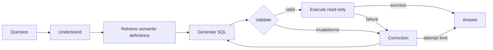

# Architecture notes

The compiled LangGraph state carries the user question, semantic context, generated SQL, validation/execution error, attempt count, result frame, and answer. Conditional routing sends invalid SQL and execution failures to bounded correction. SQL validation occurs before execution; SQLite is opened in read-only URI mode with `query_only=ON`.

Mock mode is deterministic and limited to documented templates. Groq mode sends the schema, retrieved semantic definitions, and user question to the configured model. Secrets are read from environment variables.
